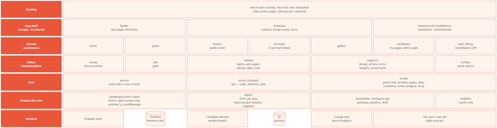
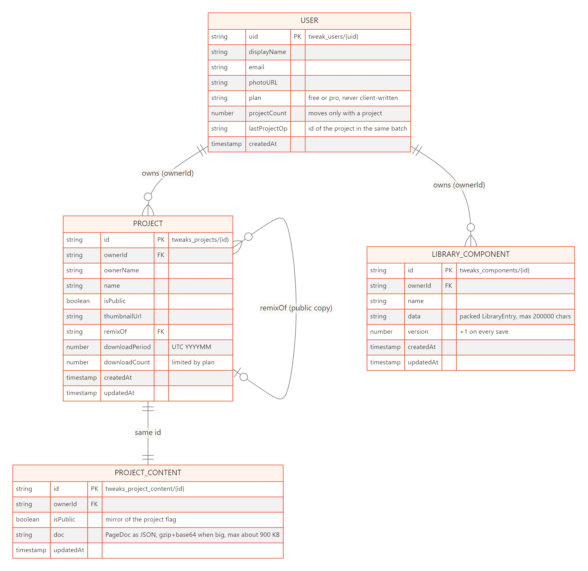
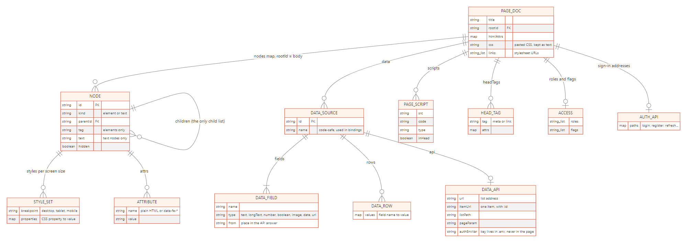
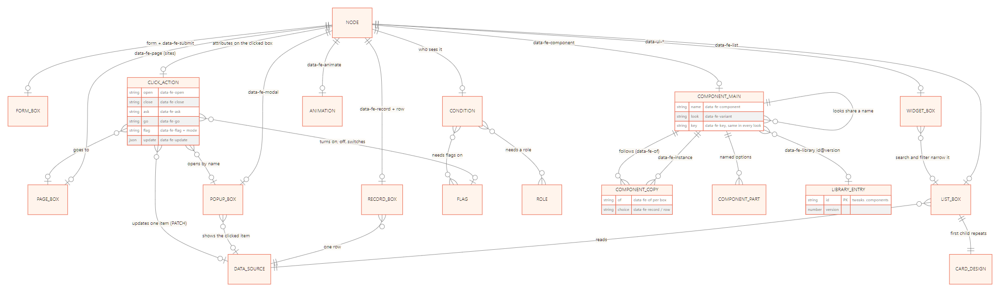

# How Tweak works: the workflow in pictures

Nine diagrams, from what a person does to how the code is built and shipped. Each picture is drawn from a
Mermaid file in [`diagrams/`](diagrams) (`.mmd`, readable and editable as text) and saved as `.svg` and `.png`.

| # | Diagram | Question it answers |
| --- | --- | --- |
| 1 | [The journey](#1-the-journey) | What does a person do, from first visit to download? |
| 2 | [Inside the editor](#2-inside-the-editor) | How does a click become an edit on screen? |
| 3 | [The page model](#3-the-page-model) | What is a page made of, and how are features marked? |
| 4 | [From page to files](#4-from-page-to-files) | How does the page become HTML, a .zip or a React project? |
| 5 | [Accounts, saving and sharing](#5-accounts-saving-and-sharing) | Where does the work live? |
| 6 | [Data](#6-data) | How do lists, tables, filters and pop-ups get their items? |
| 7 | [Reusable components](#7-reusable-components) | How does one change reach every copy? |
| 8 | [Building and shipping](#8-building-and-shipping) | How do we check, build, and make it findable? |
| 9 | [System architecture](#9-system-architecture) | Which layers does the app have, and what sits in each? |

## 1. The journey


Five stages: discover, start, build, check, keep and share. The two dotted arrows are the loops: keep editing after
a Preview, and reopening a React project that Tweak made.

## 2. Inside the editor


Every edit goes through one path: an **action** makes a **commit**; the commit carries component changes to copies and
saves one undo step; the changed boxes are sent into the **sandboxed frame**, which patches only what changed. The frame
never touches the app (no `allow-same-origin`): it only answers questions (where is this box, what is its style).

## 3. The page model


A page is a flat map of boxes plus the original CSS kept as text. Features are plain attributes on boxes
(`data-fe-*` for the editor, `data-ui-*` for ready-made parts that must survive into the React project).

## 4. From page to files


Two roads: the visitor road (`forVisitors`, used by Preview, shared pages and downloads) and the React road. The React
download also carries the hidden `.tweak/project.json`, which is how a project can be opened again.

## 5. Accounts, saving and sharing


Without an account the work is a draft in the browser. With one, autosave writes a squeezed copy to Firestore (with a
plain message when it is too big), pictures go to R2 through a small Worker, and shared pages feed Explore.

## 6. Data


One data source can be shown as a list of cards, a table, one item, or the item of the card that was clicked. Search
and filters narrow lists and tables; a filter's choices can come from another source (for example categories).

## 7. Reusable components


A copy is made of ordinary boxes, so it is edited in place. A change to the main component reaches a copy only where
that copy still has the old value.

## 8. Building and shipping


Every feature goes through the same checks before it is merged. The build also writes a static page for each public
screen, `robots.txt` and (when `VITE_SITE_URL` is set) `sitemap.xml`.

## 9. System architecture



Layers from the host down to the services. Features never reach into another feature's internals; everything the editor
does goes through actions into the stores and the model, and the sandboxed frame, the exports and saving hang off that core.

## 10. ER: saved data



The four Firestore collections. A user owns pages and library components; a page is two documents with the same id
(listable details, and the content itself); a public copy points at its original with `remixOf`.

## 11. ER: the page document



What the `doc` string inside a page's content holds: one flat map of boxes (the only child list is `children`), their styles
per screen size and attributes, plus data sources with fields, rows and an optional API, scripts, head tags and access.

## 12. ER: features on boxes



Almost every feature is a set of attributes on a box. This shows what points at what: lists and records read a data source,
clicks open pop-ups, go to pages, change flags or update one item of a source, conditions need flags and roles, and component
copies follow their main component, which can link back to a library entry.

---

**In the app:** with `npm run dev` running, open `/dev` for these diagrams (zoom, Mermaid source) next to the architecture
doc and a searchable code reference. That page exists only in development.

**Changing a diagram:** edit its `.mmd` file, then run `node scripts/diagrams/render.mjs` (needs Chrome and an internet
connection for the Mermaid script) and commit the `.svg` and `.png` files. GitHub also draws the `.mmd` text directly if
you paste it into a ```` ```mermaid ```` block.

See also: [ARCHITECTURE.md](ARCHITECTURE.md) (details and rules) and [HISTORY.md](HISTORY.md) (what each feature added).
